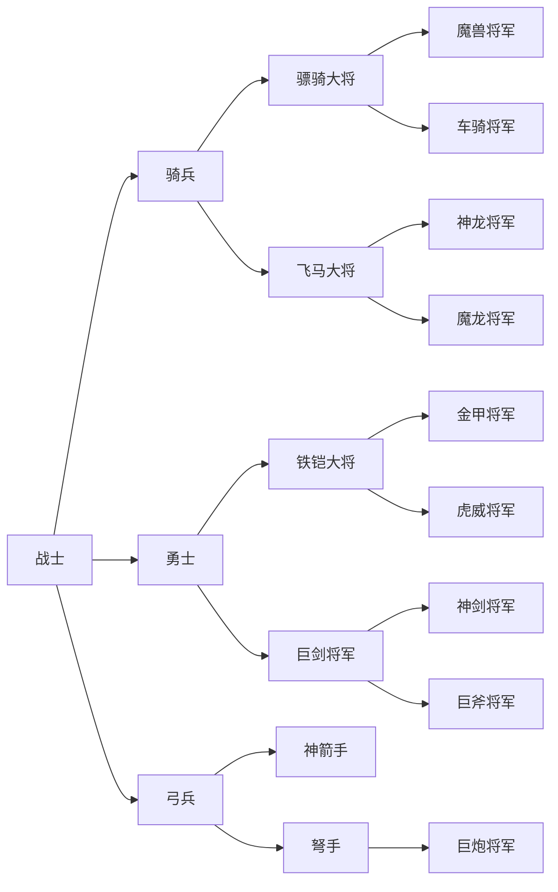
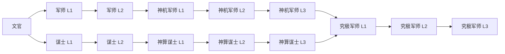

# 兵种成长与技术效果参考

本文把说明书、转职表、ROM 类型记录与技术包整理成便于查阅的规则索引。类型和包的完整机器数据保存在[兵种数据](../data/rom_class_reference.json)、[成长数据](../data/rom_progression.json)与[技术效果数据](../data/rom_technique_effects.json)。

## 资料如何合并

- 手册和转职流程 DOC 提供职业名称、职业树、技能名称、游戏显示的效果和经验门槛。
- ROM 13 字节类型记录提供最大 HP、攻击、防御、移动、技术 ID、图像 selector 和经验奖励参数；升级比较门槛另在 ROM 独立表中。
- ROM 技术指针表提供效果量、目标距离和范围包；程序例程与受控 FCEUX 轨迹用于核实治疗/扣血、目标阵营和范围形状。
- ID/name 的拼接依据手册职业表顺序与 ROM 类型/技术 ID 对照。手册没有直接列 ROM 技术 ID，所以名称与 ID 的配对仍属跨资料映射，不表示每个名称和状态效果都已由 ROM 程序独立确认。

## 武将职业进阶

下表门槛按用户提供的转职流程表记录；精确类型 ID、ROM 阈值与差异另见 JSON。分支结构由 bank 2 分支选择号和 bank 10 目标类型指针确认。

下图将资料中的路径合并成职业分支。节点表示职业阶段，不表示单个类型 ID；具体等级、类型和门槛以[成长数据](../data/rom_progression.json)为准。职业名来自资料映射，分支目标由 ROM 指针交叉核对。

| 进阶路径 | 手册门槛序列 |
|---|---|
| 战士 → 骑兵 → 骠骑大将 → 魔兽将军 | 100 → 180 → 300 → 500 → 750 → 1000 → 1400 → 1650 → 2300 |
| 战士 → 骑兵 → 骠骑大将 → 车骑将军 | 100 → 180 → 300 → 500 → 750 → 1000 → 1400 → 1700 |
| 战士 → 骑兵 → 飞马大将 → 神龙将军 | 100 → 180 → 300 → 500 → 800 → 950 → 1300 → 1700 → 2300 |
| 战士 → 骑兵 → 飞马大将 → 魔龙将军 | 100 → 180 → 300 → 500 → 800 → 950 → 1300 → 1700 → 2300 |
| 战士 → 勇士 → 铁铠大将 → 金甲将军 | 100 → 180 → 300 → 480 → 720 → 1000 → 1350 → 2000 |
| 战士 → 勇士 → 铁铠大将 → 虎威将军 | 100 → 180 → 300 → 480 → 720 → 1000 → 1300 → 2180 |
| 战士 → 勇士 → 巨剑将军 → 神剑将军 | 100 → 180 → 300 → 480 → 720 → 1000 → 1400 → 2180 |
| 战士 → 勇士 → 巨剑将军 → 巨斧将军 | 100 → 180 → 300 → 480 → 720 → 1000 → 1400 → 2180 |
| 战士 → 弓兵 → 神箭手 | 100 → 220 → 400 → 880 → 2000 |
| 战士 → 弓兵 → 弩手 → 巨炮将军 | 100 → 220 → 400 → 600 → 850 → 1100 → 1400 → 2000 |

## 文官进阶

文官的两条成长线在究极军师处汇合；各级门槛见下表和 JSON 逐条记录。

| 进阶路径 | 手册门槛序列 |
|---|---|
| 文官 → 军师 L1 → 军师 L2 → 神机军师 L1 → L2 → L3 → 究极军师 L1 | 100 → 260 → 520 → 850 → 1200 → 1400 |
| 文官 → 谋士 L1 → 谋士 L2 → 神算谋士 L1 → L2 → L3 → 究极军师 L1 | 100 → 280 → 520 → 800 → 1100 → 1400 |
| 究极军师 L1 → L2 → L3 | 1400 → 1700 → 2000 |

注意：转职流程 DOC 与 ROM 交叉表自身也有重名/称谓差异；类型 ID 是代码事实，名称是文档映射。不要仅凭中文名称猜转职目标，实际 ROM 选择表见技术细节文档。

## 手册中的技术名称与 ROM 技术 ID

### 武将技术

手册中的数值与范围是玩家参考资料；ROM 包另行解码。正交范围代码 5 的实际执行已有受控轨迹确认；图表中标为范围 4 的项目不能直接当作已验证 ROM 区域形状。

| ID | 手册职业/名称 | 手册效果 | ROM 包：效果量 / 最大距离 / area code |
|---:|---|---|---|
| 1 | 弓兵 A：射击 | 伤害 20，距离 2 | 20 / 2 / 1 |
| 34 | 弓兵 B：射击 | 伤害 30，距离 1–3 | 30 / 3 / 1 |
| 2 | 弩手 A：重弩 | 伤害 45，距离 2–3 | 45 / 3 / 1 |
| 3 | 弩手 B：高级重弩 | 伤害 40，距离 2–3 | 40 / 3 / 5 |
| 4 | 弩手 C：超强重弩 | 伤害 50，距离 2–4 | 50 / 4 / 5 |
| 5 | 神箭手 A：神箭 | 伤害 50，距离 2–4 | 50 / 4 / 1 |
| 6 | 神箭手 B：火枪 | 伤害 80，距离 2–4 | 80 / 4 / 1 |
| 7 | 神箭手 C：火箭 | 伤害 95，距离 2–5 | 95 / 5 / 1 |
| 8 | 巨炮 A：炮击 | 伤害 80，距离 2–5 | 80 / 5 / 1 |
| 9 | 巨炮 B：重炮 | 伤害 80，距离 2–6 | 80 / 6 / 5 |
| 10 | 巨炮 C：飞弹 | 伤害 80，距离 2–8 | 80 / 8 / 9 |
| 11 | 魔龙战将 A：猛龙尾扫 | 伤害 50，距离 0 | 50 / 0 / 4 |
| 12 | 魔龙战将 B：恶龙尾扫 | 伤害 60，距离 0 | 60 / 0 / 4 |
| 13 | 魔龙战将 C：大龙压 | 伤害 75，距离 0 | 75 / 0 / 4 |
| 14 | 魔龙战将 D：巨龙压 | 伤害 80，距离 0–1 | 80 / 1 / 8 |
| 15 | 神龙战将 A：神龙雷鸣 | 伤害 60，距离 1–2 | 60 / 2 / 1 |
| 16 | 神龙战将 B：神龙雷击 | 伤害 75，距离 1–3 | 75 / 3 / 1 |
| 17 | 神龙战将 C：神龙电击 | 伤害 85，距离 1–4 | 85 / 4 / 1 |
| 18 | 神龙战将 D：神龙雷电 | 伤害 100，距离 1–4 | 100 / 4 / 1 |

`area code` 是 ROM 包原值：1、5、9 的中心/十字/九宫含义已由效果例程和受控测试核实；4、8 的语义尚未确认。手册的射程下限没有放进 ROM JSON，因为当前提取只确认了包中的最大距离，菜单光标实际允许的最小距离仍需追踪。

### 文官技术变体

手册按职业级别列治疗/恢复和攻击术；ROM 技术 ID 19–33 各有 2–4 个变体。下列映射按职业顺序与包效果量对齐。`+` 表示包进入加 HP 路径，`−` 表示扣 HP；距离为解码包的最大格数。

| ID | 职业 | 变体顺序：手册名称（手册效果） | ROM 包摘要（量 / 最大距离 / area code） |
|---:|---|---|---|
| 19 | 文官 | 初级治疗（20）；初级火攻（25） | +20 / 2 / 1；−25 / 2 / 1 |
| 20 | 军师 A | 初级治疗（35）；中级火攻（30） | +35 / 3 / 1；−30 / 3 / 1 |
| 21 | 军师 B | 中级治疗（45）；纵火（45） | +45 / 3 / 1；−45 / 3 / 1 |
| 22 | 谋士 A | 初级恢复（30）；霜冻（冻结 1 回合） | +30 / 2 / 5；0 / 3 / 1 |
| 23 | 谋士 B | 中级恢复（40）；冰霜（手册写冻结 11 回合） | +40 / 3 / 5；0 / 4 / 1 |
| 24 | 神机军师 A | 中级治疗（50）；初级火龙（55）；初级落石（30） | +50 / 4 / 1；−55 / 4 / 1；−30 / 4 / 5 |
| 25 | 神机军师 B | 高级治疗（75）；中级火龙（65）；中级落石（35） | +75 / 4 / 1；−65 / 4 / 1；−35 / 4 / 5 |
| 26 | 神机军师 C | 高级治疗（75）；高级火龙（75）；高级落石（40） | +75 / 5 / 1；−75 / 5 / 1；−40 / 5 / 5 |
| 27 | 神算谋士 A | 中级恢复（40）；初级冰雪（冻结 1 回合）；初级咒语（20） | +40 / 4 / 5；0 / 0 / 4；−20 / 4 / 5 |
| 28 | 神算谋士 B | 高级恢复（45）；中级冰雪（冻结 1 回合）；中级咒语（25） | +45 / 4 / 5；0 / 0 / 4；−25 / 5 / 5 |
| 29 | 神算谋士 C | 高级恢复（50）；高级冰雪（冻结 1 回合）；高级咒语（30） | +50 / 5 / 5；0 / 0 / 8；−30 / 5 / 5 |
| 30 | 究极军师 A | 究极治疗（85）；初级火神（90）；究极落石（50）；第四变体未列名 | +85 / 5 / 1；−90 / 5 / 1；−50 / 5 / 5；0 / 5 / 9 |
| 31 | 究极军师 B | 治愈（100）；中级火神（100）；落星（70）；借刀杀人（80） | +100 / 6 / 1；−100 / 6 / 1；−70 / 6 / 5；−80 / 6 / 1 |
| 32 | 究极军师 C | 究极恢复（60）；高级火神（120）；落月（85）；战术导弹（80） | +60 / 6 / 9；−120 / 6 / 1；−85 / 6 / 5；−80 / 20 / 9 |
| 33 | 究极军师 D | 全愈（80）；究极火神（150）；落日（100）；核攻击（100） | +80 / 6 / 9；−150 / 6 / 1；−100 / 6 / 5；−100 / 20 / 9 |

表中零效果包不能解释为“什么也不做”：手册声称其中有冰冻效果，但 ROM 包第四字节、持续时间和状态写入流程尚未解码，因此冻结行为与手册的“11 回合”记录仍未确认。ID 30 第四变体也只有 ROM 的 0 效果九宫包，没有手册名称。

已由结算例程和受控实验确认的三种区域形状如下。`施` 是玩家选定的中心格，`效` 是结算格；语义尚未确认的 area code 4、8 不在图中推测。

| area code 1：中心 | area code 5：正交十字 | area code 9：九宫格 |
|---|---|---|
| `施/效` | `· 效 ·` `效 施 效` `· 效 ·` | `效 效 效` `效 施 效` `效 效 效` |

## 已确认的技术结算规则

- 技术 ID 指向一组变体包；玩家在目标选择前选定变体。可选变体数量由技术 ID 确定。
- ID 19–33 的变体 0 走恢复 HP 分支；当前确认的正数包在范围内加 HP 并以最大 HP 封顶。其它变体多数走伤害扣血路径。
- area code 1 选中心单位；5 选中心和四个正交邻格；9 选中心和八邻格。受控区域实验验证中心先结算，不因同格多槽自动追加中心目标。
- 伤害筛选对立阵营；治疗筛选施术者所属的可治疗阵营。HP 归零的目标转为失效状态；复刻版不支持复活。
- 当前尚未确认技术资源消耗、零效果状态包的完整语义、玩家原版目标选择最小距离、所有敌方 AI 变体选择和全部技术动画。

## 经验门槛的来源差异

转职 DOC、技术参数图和 ROM 阈值表之间不能压成单一来源。`rom_class_reference.json` 按每一类型同时保留手册门槛、图表门槛、类型记录经验字段，并生成冲突列表；真正升级比较取自独立 ROM 表 `$97AD`。

| 类型 ID | 职业级别 | 图表 / 手册 | ROM 类型记录字段 | 说明 |
|---:|---|---:|---:|---|
| 14 | 铁铠大将 L2 | 480 / 480 | 400 | ROM 字段与升级阈值表角色不同；升级比较看独立表 |
| 17 | 巨剑将军 L2 | 480 / 480 | 400 | 同上 |
| 26 | 魔兽将军 L2 | 1320 / 1400 | 1320 | 图表与 ROM 相同，手册不同 |
| 30 | 车骑将军 L2 | 1350 / 1400 | 1350 | 图表与 ROM 相同，手册不同 |
| 40 | 神龙将军 L4 | 2200 / 2300 | 2200 | 图表与 ROM 相同，手册不同 |
| 45 | 虎威将军 L2 | 1400 / 1300 | 1400 | 图表与 ROM 相同，手册不同 |

其余图表展示的 50 个经验字段与 ROM 类型记录字段相同。类型记录偏移 4–5 是经验相关数据，但实际升级比较使用 `$97AD`；不要以某一张静态图表覆盖程序表或误称字段语义。

## 技术参数图的状态

图表中的 0–55 类型名称/等级对照、职业分支、属性、移动力和武将技术已转录到 `rom_class_reference.json` 与提取脚本，并与 ROM 固定记录做逐项对照。手册与 ROM 技术包还补齐了图表未覆盖的文官技能及其变体。图像本身不是运行资源，也不再是构建、游戏或文档查阅的唯一入口；唯一可保留的用途是作为原始出处截图。原图仍在仓库外，本仓库没有为它添加资源依赖。
