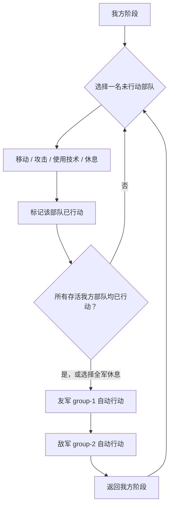

# 爆笑三国玩法与战役系统

本文把说明书和转职流程表中的玩家规则，与 ROM 静态解码和模拟器实验结果放在一起说明。配置 JSON 保存逐项数据；本文解释这些数据在战役中的含义，以及已知的复刻边界。

## 资料与可信度

- 原版中文说明书记载了序言、故事、键位、继续游戏、19 关、兵种树和技术表；兵种树与表格结合页面图形和可提取文本整理。
- 中文转职流程资料补充了逐级转职门槛；门槛另与 ROM 中的等级、经验和转职数据交叉核对，未能确认的差异在对应数据文档中标明。
- “ROM 静态解码”表示从程序、指针表或数据结构得到；“ROM 运行证据”表示 FCEUX/OpenEmu 中的受控操作或轨迹；“手册记载”表示原说明书说法，尚不自动等于 ROM 已验证；“复刻实现”专指 Godot 当前行为。
- ROM 数据文件和实验记录的入口见[ROM 研究索引](RESEARCH.md)和[ROM 技术细节](ROM_TECHNICAL_DETAILS.md)。

手册序言还包含卡带插入、开机等待、复位后关机和定时休息等主机时代使用建议；这些属于硬件说明，不是 ROM 游戏规则。手册把游戏概括为 24 个兵种；ROM 实际有 72 个有效类型记录，手册/图表提供的中文职业名只覆盖其中部分成长序列，所以文档按类型 ID、等级和职业分开记录，不把“24”解释成 ROM 类型数。

## 故事背景

手册把玩家定位为刘备军，先经历剿灭黄巾、讨伐董卓、火烧博望、赤壁和争夺荆州，再进军西蜀、形成三国鼎立；后段则允许玩家改变故事走向，夺取吴地并进兵岐山，目标是一统天下。序言还说明游戏将恶搞风格与策略/RPG成长结合。手册没有逐关剧本文字；ROM 画面实验另确认了开场故事卡片的刘备卖草鞋、英雄勇武、桃园结义等内容。

## 游戏流程

手册描述的流程是：启动后选择新游戏或继续游戏；新游戏选择难度后播放序幕并进入第一关，继续游戏则从已有记录中选一项载入。实际 ROM 观察确认玩家可见标题、开始/读取进度菜单、容易级/熟练级/高手级难度页、故事卡片和第一关战场。发行商开机画面是更早的卡带画面，不是玩家看到的标题菜单。

手册将游戏定位为策略加 RPG：每关控制己方部队移动、攻击、使用技术或休息，通过战斗取得经验、转职，并利用地图地形完成该关胜利条件。ROM 已确认共有 19 条战场记录；各关名来自手册：

| 关 | 手册关卡名 | ROM 地图 |
|---:|---|---|
| 1 | 宛城之战 | 16×30 |
| 2 | 征讨余党 | 16×30 |
| 3 | 己水之战 | 16×30 |
| 4 | 攻克洛阳 | 16×30 |
| 5 | 救援徐州 | 16×30 |
| 6 | 守卫徐州 | 16×30 |
| 7 | 火烧博望 | 16×30 |
| 8 | 新野城破敌 | 16×30 |
| 9 | 乌林水战 | 16×30 |
| 10 | 赤壁之战 | 16×45 |
| 11 | 荆州争夺战 | 16×45 |
| 12 | 白帝城之战 | 16×30 |
| 13 | 成都之战 | 16×30 |
| 14 | 益州大战 | 16×45 |
| 15 | 江夏之战 | 16×45 |
| 16 | 建业会虞 | 16×45 |
| 17 | 兵出岐山 | 16×30 |
| 18 | 函谷关大战 | 16×45 |
| 19 | 函谷关大战 | 16×45 |

第三关名和第十八、十九关重复名称照录手册，没有借地图结构擅自改名。地图尺寸来自 ROM，而不是关卡标题。

## 键位与菜单

| 输入 | 手册记载 | ROM 观察 / 复刻说明 |
|---|---|---|
| 十字键 | 移动游标、选择己方行动方向或攻击对象 | ROM 战场光标按格移动；纵向地图随 Y 方向滚动 |
| A | 确认、弹出战斗选单 | 当前复刻战场以 A 确认单位指令 |
| B | 取消前一个指令 | 当前菜单逐层返回；地图上的取消细节仍需按原版流程对照 |
| Start | 开始游戏、弹出状态选单 | FCEUX 战场观察到全军休息、全军撤退、战斗动画、读取进度、储存进度、音乐等项目 |
| Select | 手册说无作用 | 尚无需要它的已确认玩法 |

新游戏难度选项名已在 ROM 运行画面看到，但各难度对敌我属性、经验或 AI 的影响还没有逐项解码。手册没有记录这些差异。

## 战场行动与回合

手册列出移动、攻击、技术、原地休息四类部队行动，并提及撤退。ROM 把行动状态保存在已行动单位列表中；当存活的玩家单位都完成行动后，玩家阶段结束。全军休息会替尚未行动的存活单位补上休息状态并提前推进阶段。随后先处理 group-1 友军，再处理 group-2 敌军；已确认的敌军槽位循环为倒序。敌方决策只部分解出，不能把现有 AI 当成全关卡的完整原版算法。

图中概括已解出的回合阶段顺序。胜负条件并非所有关卡都已还原；哪些操作会触发终局仍有未确认项，详见[胜负回调与研究边界](ROM_TECHNICAL_DETAILS.md#8-玩家行动敌方调度与胜负回调)。

地图由 16×15 格的屏幕页上下连接，世界高度为 30 或 45 格。前九关和第十二、十三、十七关是 16×30；其余八关是 16×45。垂直滚屏上限分别为 15、30 格。关卡地图、部署和可通行地图码见[战场数据](../data/rom_battle_stage_records.json)、[部署数据](../data/rom_stage_unit_layouts.json)和[移动规则](../data/rom_stage_movement_rules.json)。

ROM 的移动辅助例程使用兵种移动点与曼哈顿格距比较：`|ΔX| + |ΔY|`。兵种移动点来自类型记录第 8 字节（偏移 7）；每关另有可通行地图码表。这个辅助例程没有显示地形加权消耗。Godot 还要求可达路径不穿过障碍和占用格，这是复刻版的寻路限制，ROM 中逐格路径算法尚未完整跟踪。

普通攻击只查找上下左右相邻目标。其 ROM 伤害计算为：攻击力减防御力若非负，则 `floor((攻击力 - 防御力) / 2) + 20`；若差值为负但不低于 -16，造成 16；更低则造成 8。伤害扣除当前 HP，降至 0 时单位失效。该公式及上下限由 bank 2 例程静态解码，复刻版普通攻击复用它。

单体休息的 ROM 恢复量是最大 HP 的整数八分之一，且不超过最大 HP；最大 HP 为 100 时恢复 12。休息会消耗该单位行动。

## 主帅、部队与失败

手册说前十关由刘备固定统领；后九关可以重组选将，最先选中的人为该战役主帅。手册还称主帅阵亡或逃走会导致全军覆没。后九关的 roster 选择上限从 6 到 12 人不等，具体数字按关记录在[部署数据](../data/rom_stage_unit_layouts.json)和战役界面中。当前项目另有 20 人的可成长队伍。

手册提醒第七、八关注意“刘彰”，称其是神秘人物。原件文字如此；这可能是人物名误植，但还没有 ROM 证据足以据此更正或定义其事件。

首关 ROM 路径已经确认 group-2 敌军全部清除是胜利条件；原版胜利会增加关卡索引，十九关之后转入独立结局回调。其它关存在目标区胜利条件，例如第五关和第六关，但所有关卡胜利谓词还没有完成逐项静态解码与运行验证。复刻版的连续通关条件是当前实现，不应视为每关都已与原版等价。

## 经验、升级与战役继承

战斗中的经验是 16 位累计值。ROM 类型定义偏移 10、11、12 分别被载入攻击基础经验、技术基础经验、击杀附加经验参数。普通攻击先加基础经验；技术只要产生非空目标表就加一次技术基础经验，每个被击倒目标另加击杀经验。经验不会在升级时扣掉门槛。普通攻击或技术结算后检查升级；移动、休息不触发该次检查。升级检查使用独立门槛表，而不是单位属性记录偏移 4–5 的“经验相关值”。

达到门槛后，自动升级或由分支选择器给出转职选项。ROM 用类型记录中的分支选择号索引 bank 10 的目的类型表；当前 HP 的计算会保留升级前缺失的 HP：`新 HP = 新最大 HP - 原缺失 HP`。跨关队伍类型和经验会继承。复刻版实现了经验、分支升级和继承；原版升级画面与完整自然升级录制仍未完成。

完整转职路径和门槛列在[兵种与技术参考](CLASS_AND_TECHNIQUE_REFERENCE.md)；逐单位数值及 ROM 阈值在[兵种数据](../data/rom_class_reference.json)和[成长数据](../data/rom_progression.json)。手册与 ROM 对两处门槛存在冲突，已在参考文档单列，不能把经验属性字节误当升级门槛。

当前 Godot 的保存文件是本项目的 JSON 战役存档，不是 FC 电池存档或 NES 模拟器存档。手册只描述从“继续游戏”读取旧进度；原版电池存档内部格式尚未完整逆向。

## 规则状态摘要

| 项目 | 已知状态 |
|---|---|
| 19 关地图页数与纵向滚屏 | ROM 数据已解码 |
| 首关部署和首关胜利条件 | ROM 数据/代码已确认 |
| 类型属性记录与 0–71 移动点 | 固定记录与消费代码已静态解码 |
| 普通攻击公式与休息恢复 | ROM 例程已静态解码 |
| 经验奖励、阈值、分支与 HP 保留 | ROM 代码/表已静态解码，部分受控轨迹验证 |
| 技术包效果、范围筛选 | ROM 代码和受控实验部分确认，状态效果/费用未完全解码 |
| 完整敌方 AI、所有关卡目标、原版存档格式 | 尚未完整确认 |
| Godot 移动路径、战斗动画、菜单和存档 | 有可玩实现，但其中部分是复刻版近似 |
