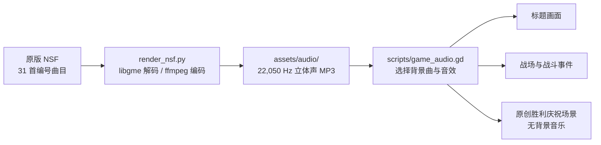

# 开场画面与 NES 音频

默认启动场景是 `scenes/intro.tscn`。启动时先播放原创的俏皮像素小剧场：原创三人组带着拿反的地图和丢失的头盔登场，按键可跳过，并在数秒后进入标题。角色图在 `assets/branding/comic_trio.png`；发行商标志不再作为开场画面显示。标题、菜单、难度页和开战前故事卡仍使用 `assets/intro/1.png`、`1a.png`、`1b.png`、`2.png`、`2a.png` 和 `2b.png` 中的 ROM 来源画面；发行商参考图与旧字符画面仍留在研究素材中。互动与时序由 `scripts/intro.gd` 控制。

提供的基础 NSF 共包含 31 首编号曲目。`research/tools/render/render_nsf.py` 使用 libgme 将其渲染为 22,050 Hz 立体声 MP3，输出到 `assets/audio/`。运行前需安装 `game-music-emu` 和 `ffmpeg`。脚本会保留已有音轨，不会覆盖它们。

图中“曲目到事件”的连线表示当前复刻版使用关系，不代表已经确认原版 ROM 的调用对应。原版结局使用哪首曲目也仍未确认。

`scripts/game_audio.gd` 当前将曲目 0 用于标题，曲目 1 用于战斗，并在部分界面和战斗事件中使用曲目 10、11、12、17、18 和 24。这些对应关系仍属暂定，需结合 ROM 的 APU 调用点和 NSF 曲目编号继续核对。长曲目目前渲染到 42 秒并在结尾循环。战斗系统菜单中的“音乐”选项可切换背景音乐，设置保存在 `user://settings.cfg`。

开场难度选择记录在本次会话的 `DemoSave.difficulty_index` 中。不同难度对应的战斗修正尚未验证，当前战斗还没有应用这些差异。

第 19 关后播放原创的像素庆祝小剧场，之后进入队伍记录；原版故事帧、员工名单和终幕不再由结尾场景播放。旧采样仍保存在 ROM 研究素材中。当前庆祝场景不播放 NSF 音乐；完整游戏的标题和战斗音轨仍来自 NSF，映射关系也仍待核对。
