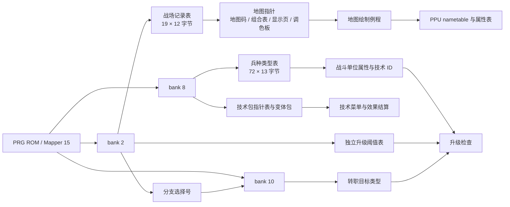
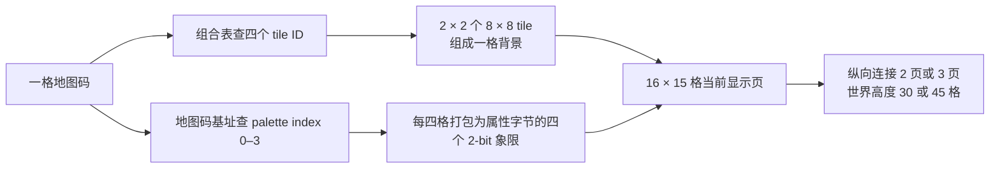

# 爆笑三国 ROM 技术细节

本文给出可以指导复刻实现的卡带布局、表结构、内存字段、程序流程和运行证据。逐项机器数据仍以 `data/` 与 `research/evidence/` 为准；本文解释字段如何被 ROM 消费，并标明尚未确定的部分。

## 1. 卡带与 PRG 映射

正在研究的简体中文版文件大小为 1,048,592 字节：16 字节 iNES 头加 1 MiB PRG。头部字节为 `4E 45 53 1A 40 00 F2 00 00 00 00 00 00 00 00 00`，声明 Mapper 15、64 个 16 KiB PRG bank、无 CHR ROM、8 KiB CHR RAM。空 PRG bank 为 48–59、62–63；其它 50 个 bank 有数据。bank 号下述均以 PRG 数据起点为基准；文件偏移需再加 0x10。

复位时首个 32 KiB PRG 映射在 CPU `$8000–$FFFF`。复位向量位于 PRG 偏移 `$7FFC`，值为 `$C003`；`$C003` 跳至 `$C025`，随后向 `$8000` 写 `$3C` 并调用新映射下的 `$8000`。Mapper 15 mode 0 的 `$3C` 对应 bank 60/61 组成的 32 KiB 程序窗口。该发现把启动路径带到高 bank，但不能据此推定其它 callback 请求号和物理 bank 的映射。

| 子系统 | bank / CPU 地址 | 已知用途 |
|---|---|---|
| 重置向量 | 初始映射，PRG `$7FFC` / CPU `$FFFC` | 进入 `$C003` 启动跳转 |
| 高 bank 启动 | bank 60，`$8000` 起 | 初始化、图形上传和启动屏绘制 |
| 单位槽定义 | bank 8，记录基址 `$8B7C` | 13 字节固定步长属性/经验参数表 |
| 技术包指针与加载 | bank 8，`$9155`；`$903F–$906F` | 按技术 ID 和变体选取技术参数包 |
| 玩家技术菜单 | bank 8，`$8F24–$903F` | 选择技术变体并加载参数包 |
| 战场记录 | bank 2，`$8610` | 19 个 12 字节地图记录 |
| 升级阈值 | bank 2，`$97AD` | 与类型记录的经验相关字段分离 |
| 升级分支指针 | bank 10，`$901F` | 将分支选择号映射为新兵种类型 |
| 结局回调 | bank 0 `$8178–$8194` 与请求 bank `$15` | 第 19 关后的分支；运行映射进入物理 bank 42 |

下面把已追踪的主要数据表与读取它们的子系统连起来。箭头表示已找到的数据消费关系；本图不推断其它 callback 请求号对应的 bank。



逐字段地址与证据级别见本节下方的数据表；可复核的机器数据见[战场记录](../data/rom_battle_stage_records.json)、[单位类型与槽位](../data/rom_unit_slot_records.json)、[成长与转职](../data/rom_progression.json)和[技术包](../data/rom_technique_effects.json)。

## 2. 战场记录与地图绘制

bank 2 的 `$8610` 开始连续存放 19 个 12 字节记录。记录按关卡索引 `$6400` 选取。Y=3 的常规战场路径把偏移 4、6、8、10 处的四个 little-endian 指针解释为地图码/调色板基址、2×2 图块组合表、显示地图起点和调色板数据包。偏移 0–2 的语义仍不完全明确；偏移 3 是可验证的纵向滚屏上限，值为 15 或 30 格。

| 记录内偏移 | 大小 | 解释 |
|---:|---:|---|
| 0–3 | 4 字节 | 头部；偏移 3 为垂直滚屏上限，其余头字段尚未逐一命名 |
| 4 | 2 字节 | 地图码/调色板基址指针 |
| 6 | 2 字节 | 每个地图码对应四个图块的 2×2 组合表指针 |
| 8 | 2 字节 | 本屏 16×15 显示地图起点指针 |
| 10 | 2 字节 | `$3Fxx` 调色板更新包指针 |

地图逻辑尺寸为 16×30 或 16×45 格，由两页或三页 16×15 的数据垂直拼接。stage 0 的 16×15 显示窗口从地图基址后 32 字节处开始；这是两整行的偏移。每格一个地图码：以地图码从组合表读取 4 个 tile ID，并画成背景图块的 2×2 方块；同一地图码从基址表取得 0–3 的调色板号。每四格的调色板号打包成 8×8 属性字节表的四个 2-bit 象限。因此地图码、tile ID 和 palette index 是三个不同概念。

ROM 绘制 worker `$A06B` 每次读 16 个地图码；`$A15B` 调用 15 行，生成当前 16×15 nametable 窗口。关卡间的 palette override 由记录指针送入 PPU `$3F08`。导出的 `rom_battle_stage_records.json` 已保存地图页、组合表、palette lookup、压缩属性表、原始指针及记录字节，供 [地图图集](map-gallery/) 与 Godot 预览使用。



三个查表结果不能混为一谈：地图码决定组合表索引和调色板索引；tile ID 指向 CHR 图块；palette index 决定该地图码使用哪组背景色。每个地图码展开为 2×2 个 tile，地图页按纵向滚屏窗口逐页绘制。

## 3. CHR RAM 与图形上传

卡带没有 CHR ROM；图块由程序上传到 PPU CHR RAM。启动例程 bank 60 `$804D` 从 CPU `$82BC–$92BB` 复制 4 KiB 到 PPU `$1000–$1FFF`。启动 nametable 流位于 `$8165`：普通字节为 tile ID，`FE count tile` 代表重复 tile，`FF` 结束；解压结果恰为 32×30 的 960 个 tile ID，随后 64 字节属性表和 `$82AC–$82BB` 的 16 色 palette。

战场加载从 bank 4 `$8000` 分派 callback `$8006`，先发三个共享 PPU 流，再从 `$804B` 的 19 项指针表读取当前关卡流。已确认的共享上传目标依次为 `$1700`、`$1910`、`$0010`；每关独有流写到 `$1010`。关卡地图组合和对应候选图可以正确组成城墙、河流、桥等结构，但战斗时完整 CHR 上传顺序和 Mapper 15 实际窗口映射仍未全部用调试器验证。因此候选背景不能一概称为逐像素复原。

bank 18 在 `$8543` 有 25 个 OAM 模板指针；固定 22 字节记录索引这些模板。共享 OAM 绘制例程 `$F072` 读 entry count，随后每项消耗 4 字节 `(Y 偏移, tile, attributes, X 偏移)`，加上当前坐标后写入 OAM shadow buffer。扩展 selector 26 通过 `$8577` 的表内别名进入 56 项 OAM 模板；与 bank 12 CHR 上传回调使用相同图形 selector 的静态关联已确认，运行时 CHR 驻留仍需验证。

## 4. 单位类型记录

bank 8 `$8B7C` 是 13 字节定长记录表，0–71 共 72 个有效类型；`$8B7C + type_id × 13` 计算记录位置。类型 72 的候选地址 `$8F24` 已是可执行代码入口，不应当成第 73 个类型。记录字段的解释来自载入目标和消费例程：

| 偏移 | 字段 | 载入/使用位置 | 证据状态 |
|---:|---|---|---|
| 0–1 | 最大 HP，小端 16 位 | `$6557/$6558` | 已确认；加载当前槽 HP 时亦用作上限 |
| 2–3 | 攻击力，小端 16 位 | `$6647/$6648` | 已确认；参与普通攻击差值 |
| 4–5 | 类型记录中的 16 位经验相关值 | `$65F7/$65F8` | 已确认会载入，但它不是转职比较所用门槛 |
| 6 | 防御力 | `$6697` | 已确认；普通攻击公式读取 |
| 7 | 移动点数 | `$66BF` | 已确认；移动例程按类型读取 |
| 8 | 技术 ID | `$66E7` | 已确认；0 表示没有关联技术包 |
| 9 | 图形 selector | `$6467` | 已确认参与 OAM/PPU 图像查找 |
| 10 | 攻击基础经验 | `$6711` | 通过攻击奖励消费确认 |
| 11 | 技术基础经验 | `$6739` | 通过技术奖励消费确认 |
| 12 | 击倒奖励经验 | `$6761` | 通过击杀奖励消费确认 |

这些值会复制进 battle-slot 数组；角色槽不是兵种类型表本身。`rom_unit_slot_records.json` 记录角色定义、组列表和字段载入目的地；`rom_stage_unit_layouts.json` 记录每关部署位置与阵营分组。`rom_class_reference.json` 给 0–55 的战士职业序列配上手册/图表名称；ROM progression 可覆盖 0–71，但类型 56–71 的名称与文官图形仍有部分不确定性。

## 5. 移动、攻击与休息例程

### 移动预算

bank 2 `$8B8A` 由活动单位槽选择 `$66BF,X` 的类型移动点，将已走预算 `$05E6` 扣除并拒绝负余量。移动距离为曼哈顿格距：

```text
距离 = abs(目标格 X - 当前格 X) + abs(目标格 Y - 当前格 Y)
```

屏幕坐标按 16 像素一格换算，并将滚屏偏移归一到地图坐标。各关还有独立可通行地图码清单。该 helper 未显示地形权重；被其它槽占据时的完整路径算法与光标逐步移动消耗尚未完全解码。当前 Godot 叠加的无障碍寻路是可玩性约束，不是已经证明的 ROM 算法。

### 普通攻击

bank 2 `$8CF0–$8D56` 搜索敌方单位并筛选四邻格。bank 2 `$8DE0–$8E2B` 算攻击减防御；非负差值右移一位再加 20，负差值但大于等于 -16 给 16 点，否则给 8 点。bank 2 `$8FA7–$8FCD` 扣除 `$05E9` 并将 HP 下限钳到 0。第一关的普通敌人 AI 只对部分分支解码，不能推演成完整 AI。

### 休息

bank 2 `$8867` 执行当前/最大 HP 的八分之一恢复，整数结果加回当前 HP，并封顶最大值。示例：最大 HP 100 恢复 12。敌人低 HP 休息也会调用同一路径。

## 6. 经验奖励与转职控制流

战斗槽和 roster 的累计经验各为 16 位：战斗 `$65F7/$65F8`，队伍 `$652F/$6530`。普通攻击在造成伤害前加定义偏移 10 的基础经验；bank 8 `$9A41–$9A5E` 对非空技术目标列表只加一次偏移 11 的技术经验；每个被击倒目标再加偏移 12 奖励。经验以 16 位累加，不按伤害比例缩放，也不会因升级清零/扣门槛。

转职比较在 bank 2 `$9657–$9675` 查询独立表 `$97AD`，类型偏移 4–5 的经验相关值不能替代它。bank 2 `$983F` 的类型分支选择号经 bank 10 `$901F` 转为目标类型：

| 分支选择号 | 转职目标类型 |
|---:|---|
| 0 | 1 / 3 / 5 |
| 1 | 7 / 10 |
| 2 | 13 / 16 |
| 3 | 19 / 22 |
| 4 | 25 / 29 |
| 5 | 33 / 37 |
| 6 | 41 / 44 |
| 7 | 47 / 50 |
| 8 | 53 |
| 9 | 57 / 59 |
| 10 | 61 |
| 11 | 64 |
| 12 | 67 |

玩家攻击或技术结算后触发一次升级检查；没有逐级循环。升级重载属性时保留受损量：新当前 HP = 新最大 HP − 旧最大 HP 与旧当前 HP 的差值。跨关时类型和经验写回 20 人队伍。阈值、选择路径和奖励值逐条见 `data/rom_progression.json`。

## 7. 技术数据与范围执行

bank 8 `$9155` 是技术包指针表；`$903F–$906F` 以技术 ID 减 1 取记录，再由 `$05CD` 变体选包，将效果量写到 `$05EB`。玩家技术菜单在 `$8F24–$903F`：1–18 与 34 只有一个选项；19–23 两项；24–29 三项；30–33 四项。菜单从变体 0 起，Up/Down 调整，B 返回，A 装载包。

技术效果例程位于 bank 8 `$9A69–$9B57`：19–33 的变体 0 走治疗路径，治疗加 HP 并封顶；伤害路径扣 HP。伤害/治疗的十字或九宫筛选在 `$96C7–$98AA`；已经受控验证的区域含义：1 为中心目标，5 为中心加四个正交邻格，9 为中心加八邻格。伤害只扫对立阵营，治疗只扫施术方可治疗阵营；多目标先处理所选中心，中心格重叠的其它槽不自动加入。HP 到 0 或下溢后状态标为 `$FF`。技术包第四个辅助字节和它所表示的资源费用/异常状态尚未解释。

ID、packet 原始字节、各变体效果量、最大距离和 area code 都在 `data/rom_technique_effects.json`。受控范围实验见 `research/evidence/traces/rom_area*_healing_effect.tsv`、`rom_area*_damage_effect.tsv` 与 `rom_skill25_variant2_damage_effect.tsv`。这些实验改变了施法状态/阵型以验证结算，不是完整的自然玩家菜单或 AI 决策录像。

## 8. 玩家行动、敌方调度与胜负回调

玩家行动列表记录已行动单位。全军休息会补齐其余存活己方单位并推进流程。bank 2 `$A764–$A838` 调度 group-1，随后 `$A839–$AA35` 调度 group-2；已分析的 group-2 循环倒序遍历。战斗状态可先结算，再由显示层逐个播报动画；复刻版事件播放不代表 ROM 自身的可视逐帧调度。

首关普通 group-2 单位的已解分支包括低于最大 HP 三分之一时休息，以及可用时攻击四邻中当前 HP 最低的目标；无相邻目标时受伤者休息，满血者可能不动。其它 AI flag 和兵种特技仍不齐。有关第一关受控行动次序和数据见研究日志及 `rom_action_scheduler_evidence.json`。

bank 0 `$8178–$8181` 胜利后增加 `$6400` 关卡号；若结果为十进制 19，则改走 bank 请求 `$15` 的独立 callback。FCEUX 中 `$15` 的运行映射在 `$8000` 是 `4C 06 80`，对应物理 PRG bank 42，callback 0 从 `$8006` 开始。受控结局轨迹采到故事、名单和终幕画面，但实验直接注入最终关状态，不是连续通关 19 关的证据。

## 9. 证据文件和可复现入口

| 文件 | 内容 |
|---|---|
| `data/rom_battle_stage_records.json` | 19 关地图记录、2×2 图块组合、地图码调色板和 PPU palette 包 |
| `data/rom_stage_unit_layouts.json` | 19 关玩家/友军/敌军部署及坐标 |
| `data/rom_stage_movement_rules.json` | 每关的可通行地图码列表 |
| `data/rom_unit_slot_records.json` | 角色/类型固定记录、组指针和字段落点 |
| `data/rom_progression.json` | 经验数组、升级阈值、分支表、奖励和 HP 更新路径 |
| `data/rom_class_reference.json` | 0–55 职业名称、类型交叉表、基础属性和部分技术名称 |
| `data/rom_technique_effects.json` | 技术包、菜单边界、效果例程和范围筛选解释 |
| `research/evidence/records/` | FCEUX 解码记录、受控实验的结构化结果 |
| `research/evidence/traces/` | RAM 快照、逐帧/逐次行动实验轨迹 |
| `research/tools/extract/` | ROM 表和效果的提取脚本 |
| `research/tools/fceux/` | 原版模拟器跟踪脚本 |

提取器从命令行接收本地 ROM 路径；原 ROM 不属于游戏资源，也不需要随 Godot 构建。每个分析段应以原始字节、消费例程、运行轨迹三类证据分别表述，避免把“在图表出现”“从代码推断”和“受控模拟器验证”合并成一个确定结论。
